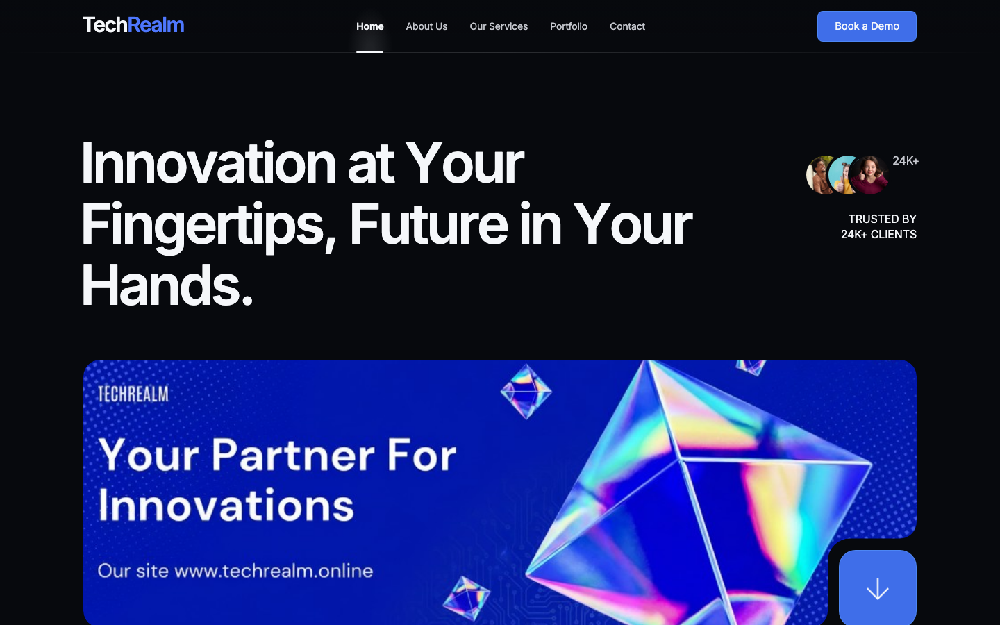
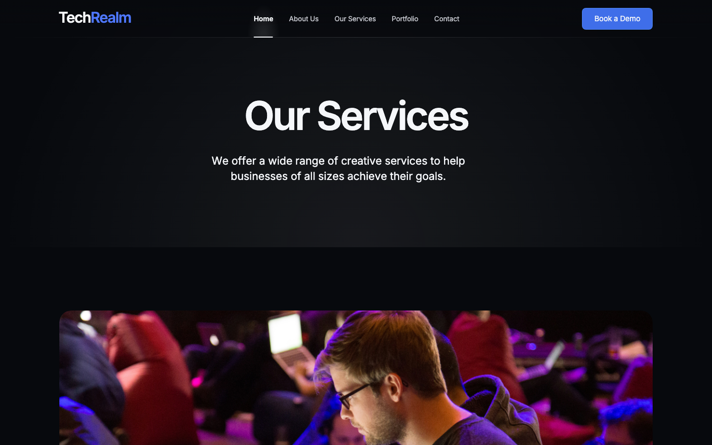
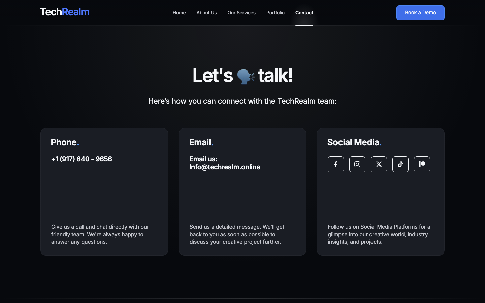
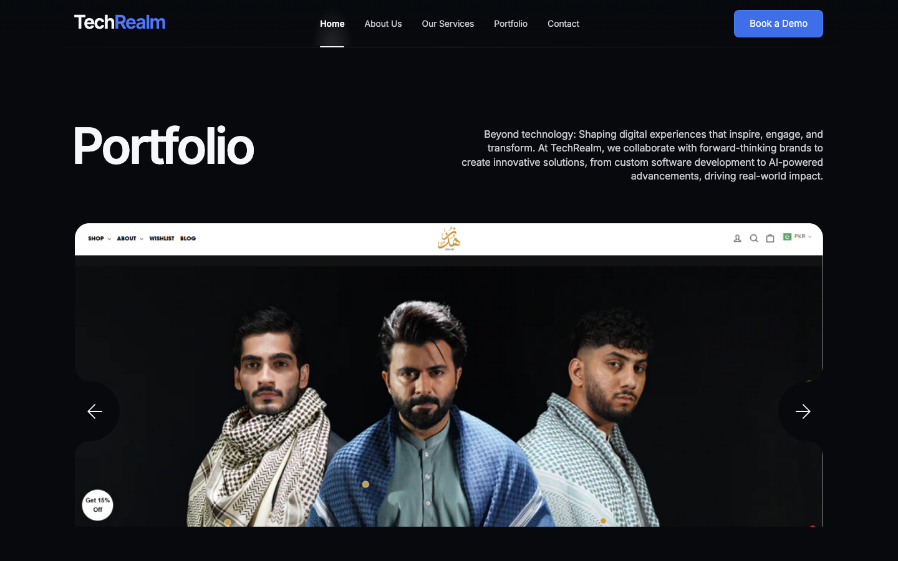
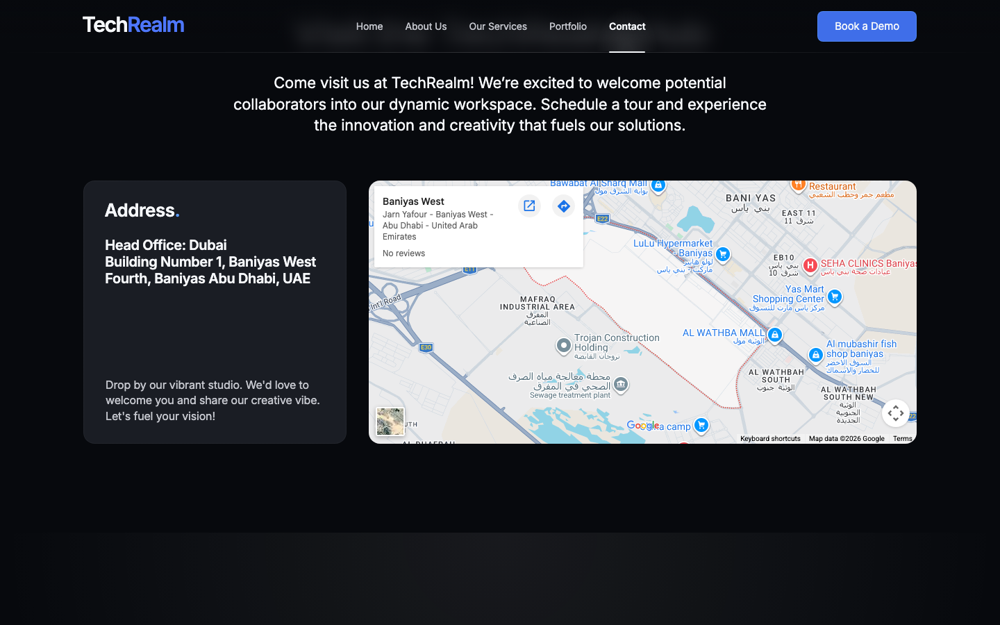
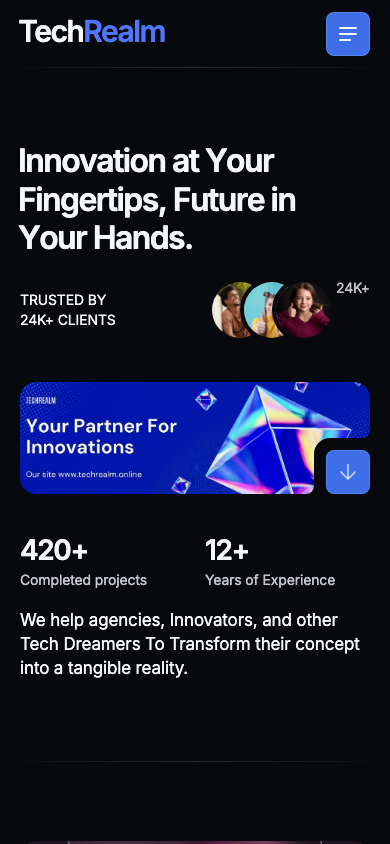
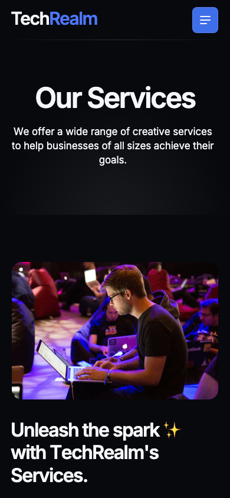

# TechRealm — Your Partner For Innovations 🚀

The marketing site for **TechRealm**, a software studio that builds web, mobile, and AI
products for agencies, innovators, and the occasional big dreamer. It's a fast, animated,
multi-page static site — no build step, no framework tax, just clean HTML/CSS/JS that loads
quick and looks sharp on everything from a 4K monitor to the phone in your pocket.

> _"Innovation at Your Fingertips, Future in Your Hands."_



---

## ✨ What's inside

- **Five real pages, one cohesive vibe** — Home, About Us, Our Services, Portfolio, and
  Contact, all wired together with a sticky frosted-glass nav.
- **Buttery scroll animations** — fade-ups, parallax media, and staggered reveals that make
  the page feel alive without janking your scroll.
- **A portfolio carousel** — swipeable showcase of real client work (e-commerce, brand sites,
  AI products, and more).
- **A contact hub that actually helps** — click-to-call, click-to-email, live socials, and an
  embedded map that points to the *right* office (Baniyas West, Abu Dhabi — no more mystery
  Denver pin 🕵️).
- **Fully responsive** — the layout gracefully collapses to a mobile hamburger menu and
  single-column stacks on small screens.
- **SEO-ready** — proper title, description, Open Graph, and Twitter card tags so links
  unfurl nicely when shared.
- **Bonus demo pages** — a `Dental-clinic/` landing and a `custom/` landing kept around as
  living examples of the kind of work TechRealm ships.

## 📸 A little tour

| Services | Contact |
| --- | --- |
|  |  |

| Portfolio | Contact map |
| --- | --- |
|  |  |

Looks just as good with your thumb doing the driving:

| Home (mobile) | Services (mobile) |
| --- | --- |
|  |  |

---

## 🏁 Getting started (zero to running in ~60 seconds)

Good news: this site is **plain static files**. There's nothing to compile and no
dependencies to install. You just need a way to serve the folder over HTTP (the pages use
root-absolute links like `/services/service.html`, so opening the file directly with
`file://` won't route correctly — a tiny local server fixes that).

### Prerequisites

- Any one of: **Python 3**, **Node.js**, or the **VS Code Live Server** extension.
- A modern browser. That's it. No, really.

### Option A — Python (already on most Macs/Linux)

```bash
# 1. Grab the code
git clone https://github.com/waleedsworld/techrealmv1-production.git
cd techrealmv1-production

# 2. Serve it
python3 -m http.server 8000

# 3. Open it
# → http://localhost:8000
```

### Option B — Node.js

```bash
npx serve .
# then open the URL it prints (usually http://localhost:3000)
```

### Option C — VS Code Live Server

Open the folder in VS Code, install the **Live Server** extension, then right-click
`index.html` → **Open with Live Server**. (The repo even ships a `.vscode/settings.json`
pinning the port for you.)

---

## 🗂️ Project structure

```
techrealmv1-production/
├── index.html            # Home
├── about/about.html      # About Us
├── services/service.html # Our Services
├── portfolio/folio.html  # Portfolio
├── contact/contact.html  # Contact (with live map + form)
├── css/                  # config, libs, styles, responsive
├── js/                   # template core + interactions
├── images/ · logos/      # media & client logos
├── Dental-clinic/        # bonus demo landing
├── custom/               # bonus custom landing
└── docs/media/           # screenshots used in this README
```

## 🎨 Tech & credits

- **HTML5 / CSS3 / vanilla JS** — no framework, no bundler.
- Motion powered by the site's own scroll-observer scripts + Swiper for the carousel.
- The UI is built on the commercial **Bringer** HTML template; all TechRealm content,
  pages, copy, and customization are our own.
- Google Fonts (Inter) for type; Google Maps embed for the office pin.

## 🌐 Live demo

**Deploying soon.** The production site lives at
[techrealm.online](https://techrealm.online) — a hosted preview link will land here shortly.

## 🤝 Want to work with us?

Hit the **Book a Demo** button anywhere on the site, or reach out from the
[Contact page](contact/contact.html). We don't see clients — we see partners. Let's build
something that outlives the hype cycle. 💡
