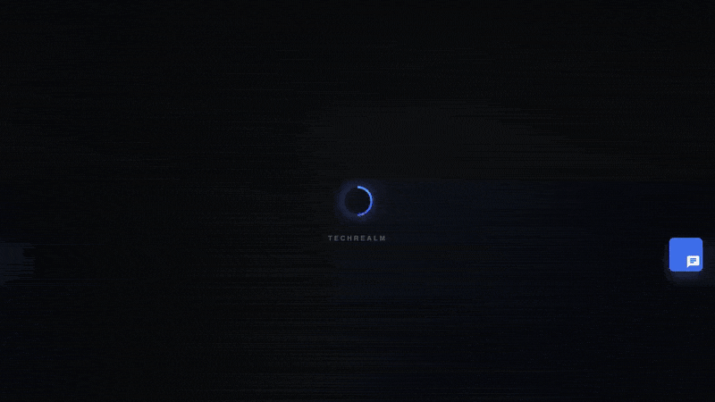
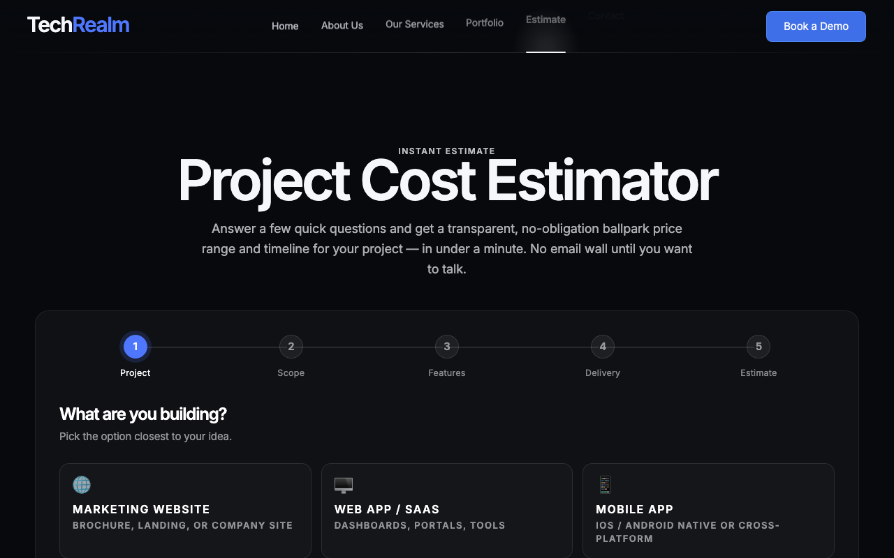
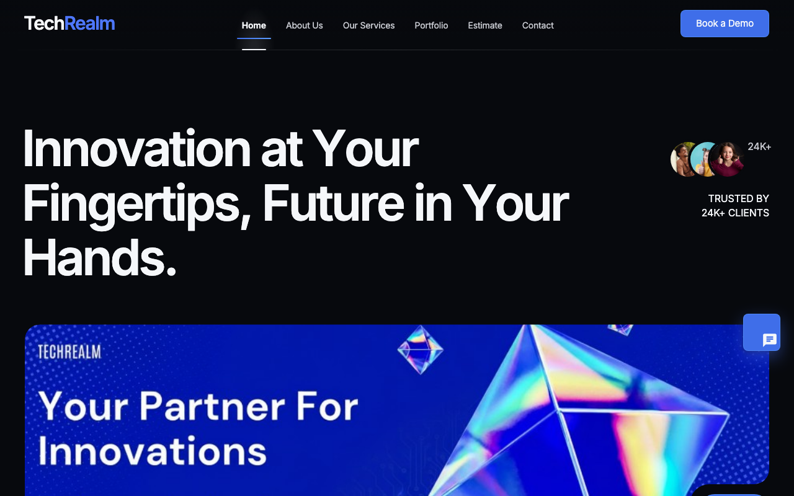
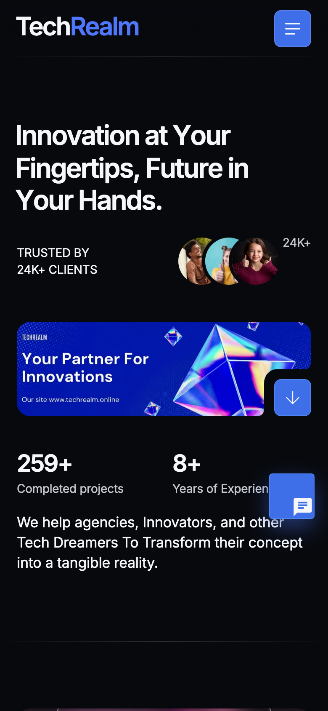
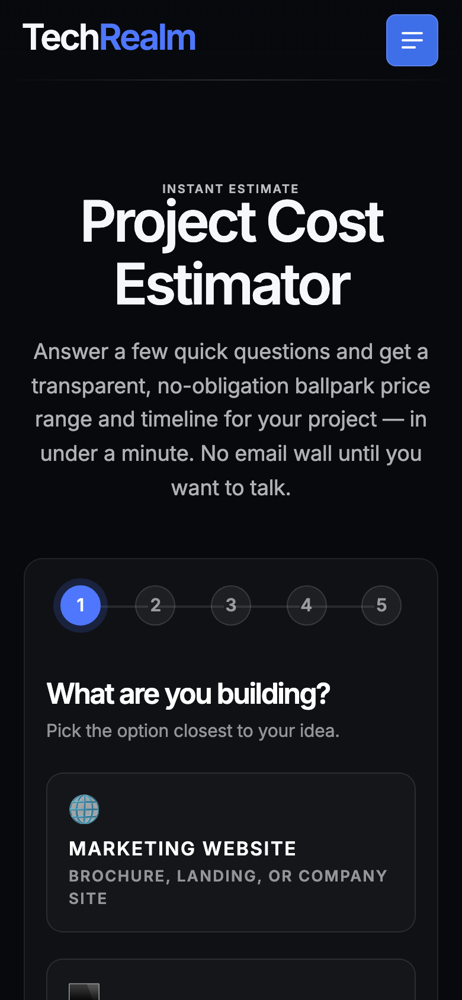

# TechRealm — Your Partner For Innovations 🚀

[](https://techrealm.online)
[](https://developer.mozilla.org/docs/Web/HTML)
[](#-getting-started-zero-to-running-in-60-seconds)
[](#-tested-like-we-mean-it)
[](site.webmanifest)
[](#-accessibility--performance)

The marketing site for **TechRealm**, a software studio that builds web, mobile, and AI
products for agencies, innovators, and the occasional big dreamer. It's a fast, animated,
multi-page static site — no build step, no framework tax, just clean HTML/CSS/JS that loads
quick and looks sharp on everything from a 4K monitor to the phone in your pocket.

> _"Innovation at Your Fingertips, Future in Your Hands."_

<p align="center">
  
</p>

<p align="center"><em>↑ Real capture: cruise the hero, then watch the new <strong>Project Cost Estimator</strong> turn a few clicks into a live, itemized ballpark quote.</em></p>

---

## 🆕 What's new in this release

This round was a deep, feature-by-feature glow-up. Eight focused workstreams landed — here's the headline act and its supporting cast:

- **🧮 Interactive Project Cost Estimator** _(the star)_ — a slick 5-step wizard
  (`/estimator/estimator.html`): pick a project type → scope → features → design & timeline,
  and watch a **live ballpark price range**, **itemized cost breakdown**, **estimated
  timeline**, and **confidence score** compute in real time. No email wall until *you* want
  one — then a friendly lead form (or a one-tap WhatsApp handoff) turns curiosity into a
  conversation. Now linked from the main nav on every page.
- **🛰️ Scroll HUD** — a top scroll-progress bar plus a circular, progress-ringed
  back-to-top button that fades in exactly when you need it.
- **📞 Quick Connect dock** — a floating action dock (bottom-right) with instant
  call / email / WhatsApp shortcuts, so a ready-to-talk visitor is never more than one tap
  from you.
- **✨ UI micro-interactions** — button ripple + sheen, card lift on hover, and buttery nav
  hover states that make the whole site feel *responsive to the touch*.
- **🛡️ Robustness hardening** — bulletproofed mobile hamburger nav, bigger touch targets,
  de-duplicated scripts, and a pile of tablet/touch/edge-case fixes.
- **♿ Accessibility & performance** — a skip-to-content link, ARIA labelling, visible focus
  rings, `prefers-reduced-motion` support, and lazy/priority image loading.
- **🧪 A real test suite** — Node unit tests + a Playwright end-to-end suite (with CI config)
  covering navigation, the contact page, the portfolio, and the mobile menu.
- **🧬 A/B hero variants** — a build-free `?variant=b` challenger hero for messaging
  experiments (see [`docs/VARIANTS.md`](docs/VARIANTS.md)).
- **🔎 Discoverability layer** — full favicon set, `robots.txt`, `sitemap.xml`,
  Open Graph / Twitter cards, JSON-LD, and an installable PWA `site.webmanifest`.

### The estimator, up close

| Step 1 — pick what you're building | Step 5 — your live ballpark estimate |
| --- | --- |
|  |  |

The estimate math runs **entirely client-side** in [`estimator/estimator.html`](estimator/estimator.html) —
no backend, no API keys, no waiting. Change a feature checkbox and the number moves the same frame.

---

## ✨ What's inside (the whole picture)

- **Five real pages, one cohesive vibe** — Home, About Us, Our Services, Portfolio, and
  Contact, all wired together with a sticky frosted-glass nav — now joined by the new
  **Estimate** page.
- **Buttery scroll animations** — fade-ups, parallax media, and staggered reveals that make
  the page feel alive without janking your scroll.
- **A portfolio carousel** — swipeable showcase of real client work (e-commerce, brand sites,
  AI products, and more).
- **A contact hub that actually helps** — click-to-call, click-to-email, live socials, and an
  embedded map that points to the *right* office (Baniyas West, Abu Dhabi — no more mystery
  Denver pin 🕵️).
- **Fully responsive** — the layout gracefully collapses to a mobile hamburger menu and
  single-column stacks on small screens.
- **Bonus demo pages** — a `Dental-clinic/` landing and a `custom/` landing kept around as
  living examples of the kind of work TechRealm ships.

## 📸 A little tour

| Services | Contact |
| --- | --- |
|  |  |

| Portfolio | Contact map |
| --- | --- |
|  |  |

Looks just as good with your thumb doing the driving:

| Home (mobile) | Estimator (mobile) |
| --- | --- |
|  |  |

---

## 🏁 Getting started (zero to running in ~60 seconds)

Good news: this site is **plain static files**. There's nothing to compile and no
dependencies to install *to run it*. You just need a way to serve the folder over HTTP (the
pages use root-absolute links like `/services/service.html`, so opening the file directly
with `file://` won't route correctly — a tiny local server fixes that).

### Prerequisites

- Any one of: **Python 3**, **Node.js**, or the **VS Code Live Server** extension.
- A modern browser. That's it. No, really.

### Option A — Python (already on most Macs/Linux)

```bash
# 1. Grab the code
git clone https://github.com/waleedsworld/techrealmv1-production.git
cd techrealmv1-production

# 2. Serve it
python3 -m http.server 8000

# 3. Open it
# → http://localhost:8000
#   estimator lives at → http://localhost:8000/estimator/estimator.html
```

### Option B — Node.js

```bash
npx serve .
# then open the URL it prints (usually http://localhost:3000)
```

### Option C — VS Code Live Server

Open the folder in VS Code, install the **Live Server** extension, then right-click
`index.html` → **Open with Live Server**. (The repo even ships a `.vscode/settings.json`
pinning the port for you.)

---

## 🧪 Tested like we mean it

New in this release: an actual, runnable test suite. No build step needed for the site —
but if you want to poke the tests, install the dev dependencies once:

```bash
npm install            # installs Playwright + friends (dev-only)
npx playwright install # one-time browser download

npm run test:unit      # fast Node unit tests (links, page sanity)
npm run test:e2e       # Playwright end-to-end (spins up a local server for you)
npm test               # both
```

The e2e suite drives a real headless Chromium across navigation, the contact page, the
portfolio, and the mobile hamburger menu. CI config is included so the same checks run on push.

## ♿ Accessibility & performance

We sweated the details that don't show up in a screenshot:

- **Skip-to-content link** and **ARIA** labelling for screen-reader users.
- **Visible focus states** so keyboard navigation is never a guessing game.
- **`prefers-reduced-motion`** support — the animations bow out politely for folks who ask.
- **Lazy-loaded imagery** with priority hints on the hero, so the first paint is snappy.

## 🧬 A/B hero variants

The home hero ships in two flavours — a control and a challenger — swapped **at runtime**
with zero build step or duplicate markup:

```
http://localhost:8000/?variant=b            # challenger hero
http://localhost:8000/?variant=b&abpreview=1 # + a floating A/B switch for internal testing
```

Full details, query params, and how to edit the copy live in [`docs/VARIANTS.md`](docs/VARIANTS.md).

---

## 🗂️ Project structure

```
techrealmv1-production/
├── index.html                 # Home (hero, portfolio carousel, services)
├── about/about.html           # About Us
├── services/service.html      # Our Services
├── portfolio/folio.html       # Portfolio
├── contact/contact.html       # Contact (live map + form)
├── estimator/estimator.html   # 🆕 Interactive Project Cost Estimator
├── css/                       # config, libs, styles, responsive
│   ├── techrealm-scrollhud.css # 🆕 scroll progress + back-to-top
│   ├── enhance.css             # 🆕 UI micro-interactions
│   ├── robustness.css          # 🆕 mobile/touch hardening
│   └── a11y.css                # 🆕 accessibility + reduced-motion
├── js/                        # template core + interactions
│   ├── techrealm-scrollhud.js  # 🆕 scroll HUD
│   ├── tr-quick-connect.js     # 🆕 Quick Connect dock
│   ├── variant-ab.js           # 🆕 A/B hero
│   ├── enhance.js · robustness.js · a11y.js
├── tests/                     # 🆕 unit + Playwright e2e + CI
├── images/ · logos/           # media & client logos
├── Dental-clinic/ · custom/   # bonus demo landings
└── docs/media/                # the GIF + screenshots in this README
```

## 🎨 Tech & credits

- **HTML5 / CSS3 / vanilla JS** — no framework, no bundler for the site itself.
- Motion powered by the site's own scroll-observer scripts + Swiper for the carousel.
- The UI is built on the commercial **Bringer** HTML template; all TechRealm content,
  pages, copy, customization, and every 🆕 feature above are our own.
- Google Fonts (Inter) for type; Google Maps embed for the office pin.
- Dev-only: **Playwright** + Node's built-in test runner for the test suite.

## 🔎 Discoverability & SEO

Everything a crawler, social preview, or "Add to Home Screen" prompt looks for — all as
static files, no server logic:

- **`robots.txt`** + **`sitemap.xml`** — crawlers get a clean map of the canonical pages.
- **Per-page `<link rel="canonical">`** — no duplicate-content ambiguity.
- **Open Graph + Twitter Card tags on every page** — links unfurl with the right title,
  description, and hero image on Slack, iMessage, LinkedIn, X, and friends.
- **JSON-LD structured data** (`Organization` + `WebSite`) — feeds Google's knowledge graph.
- **A full favicon set** — `favicon.ico`, a scalable `favicon.svg`, PNG fallbacks, and a
  180×180 `apple-touch-icon.png`.
- **`site.webmanifest`** — themed, installable PWA metadata so the site can be pinned to a
  phone's home screen.

## 🌐 Live demo

The production site is live at **[techrealm.online](https://techrealm.online)** — go kick the
tires, and try the [estimator](https://techrealm.online/estimator/estimator.html) while
you're there.

## 🤝 Want to work with us?

Hit the **Book a Demo** button anywhere on the site, tap the **Quick Connect** dock, run
yourself an estimate, or reach out from the [Contact page](contact/contact.html). We don't
see clients — we see partners. Let's build something that outlives the hype cycle. 💡
